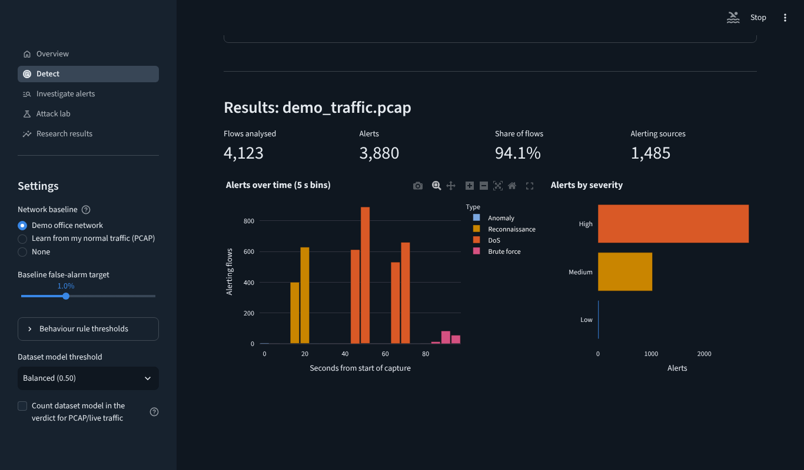

# RELIC-IDS

**A hybrid intrusion detection system for cloud and enterprise networks, and the research behind it.**

RELIC-IDS reads packet captures, flow CSV files or live traffic, groups packets into flows, scores every flow with three independent detection layers, explains each alert and keeps a history you can export as a PDF incident report.

It accompanies the paper *Beyond 99% Accuracy: A Critical Review and Re-evaluation of AI-Based Intrusion Detection for Cloud Environments* (Jayveer Vasava, M.Tech Cyber Security, Parul University), included in [`paper/`](paper/) as an IEEE two-column PDF (`Beyond_99_Accuracy_IEEE.pdf`), its LaTeX source (`paper/ieee/`) and a single-column version.



## What it does

| Page | What you can do |
|---|---|
| **Detect** | Analyse the bundled demo capture, upload a PCAP/PCAPNG or CSV, or capture live traffic. See alerts over time, severities, incidents with evidence, and download CSV or a PDF report. |
| **Investigate alerts** | Browse every saved run, filter by type, severity or IP, and open an alert to see why it fired, including SHAP feature contributions and suggested actions. |
| **Attack lab** | Take a real UNSW-NB15 attack record, change what an attacker controls (TTL, bytes, packet size) and watch a standard model get evaded while the hardened model still detects it. |
| **Research results** | Interactive versions of the paper's results. |

## How detection works

1. **Behaviour rules** find port scans, host sweeps, SYN floods, UDP and ICMP floods and brute-force logins from how a host behaves across many flows. Thresholds are adjustable in the sidebar.
2. **Network baseline** (Isolation Forest) learns normal traffic from a capture of *your* network and flags flows that do not fit. Its threshold is set from a chosen false-alarm target.
3. **Dataset ML model** (XGBoost, UNSW-NB15). For UNSW-format records it is the detector (F1 0.895 on the official test set). For your own traffic it is shown as an extra signal and is off in the verdict by default, because lab-trained models transfer poorly.

Why three layers: on the bundled demo capture the dataset model alone flagged 80% of normal flows and caught under 3% of the scan and flood traffic, while the rules caught every scripted attack with no false alarms on normal hosts. The full demo result is 100% detection of all four attack scenarios with 6.5% of normal flows flagged (by the baseline layer, as Low severity).

The live-traffic model drops TTL and other testbed artefacts. This costs 0.002 F1 on the official test set but removes the one-feature evasion shown in the paper, where setting TTL to its benign median let 99.8% of detected attacks evade the standard model.

## Quick start

Python 3.11 or newer.

**Windows**: double-click `run_windows.bat` (first run installs everything into `.venv`).

**Linux / macOS**:
```bash
./run_linux.sh          # demo and uploads
./run_linux.sh --live   # also live capture (asks for sudo)
```

**Manually**:
```bash
python -m venv .venv && source .venv/bin/activate   # Windows: .venv\Scripts\activate
pip install -r requirements.txt
streamlit run app.py
```
Then open http://localhost:8501, go to **Detect** and press **Run analysis** on the demo capture.

### Live capture
- **Windows**: install [Npcap](https://npcap.com) and run `run_windows.bat` as Administrator.
- **Linux**: `./run_linux.sh --live`.
- Live capture does not work on hosted platforms such as Streamlit Community Cloud; uploads do.

### Testing it on real attacks (your own lab only)
Run two VMs on an isolated host-only network, start a capture with RELIC-IDS on the target, and from the other VM run for example `nmap -sS <target>` (scan) or `hping3 -S --flood -p 80 <target>` (SYN flood). Only test networks you own or are authorised to test.

## Deploy online (free)
1. Push this repository to GitHub.
2. Go to [share.streamlit.io](https://share.streamlit.io), choose the repository, branch `main` and main file `app.py`.
3. Deploy. You get a public link; PCAP and CSV uploads work there.

## Repository layout
```
app.py, pages/            Streamlit app (Overview, Detect, Investigate, Attack lab, Research)
relic/features.py         packets -> bidirectional flows -> UNSW-NB15-style features
relic/rules.py            behaviour rules
relic/baseline.py         Isolation Forest baseline
relic/engine.py           XGBoost models, SHAP explanations
relic/pipeline.py         combines the three layers into one verdict
relic/store.py            SQLite history; relic/report.py PDF reports
models/                   trained models + model card
samples/                  demo capture with ground truth, normal baseline capture, UNSW-NB15 test sample, generator script
train_models.py           retrain the app models (needs UNSW-NB15 in data/)
tests/                    pytest suite (feature formulas, rules, pipeline, model)
experiments/              paper experiments: code, results JSON, figures
paper/                    the paper (PDF)
```

## Reproduce the research
```bash
# put NSL-KDD and UNSW-NB15 in data/ (see data/README.md)
cd experiments/code
python run_experiments.py && python run_relic.py
python make_figures.py && python make_relic_figures.py
cd ../.. && python train_models.py --data data && python -m pytest -q
```

## Limitations
- The demo capture is synthetic; detection on real networks depends on the rule thresholds and on a baseline learned from that network.
- Flow features follow UNSW-NB15 definitions but are computed by this tool, not Argus/Bro, so they are close but not identical.
- The dataset model is trained on lab traffic (UNSW-NB15) and is not a reliable detector on its own for other networks.

## Cite
```
@misc{vasava2026beyond,
  author = {Jayveer Vasava},
  title  = {Beyond 99\% Accuracy: A Critical Review and Re-evaluation of AI-Based Intrusion Detection for Cloud Environments},
  year   = {2026},
  note   = {Parul University. https://github.com/jayveerv/relic-ids}
}
```
